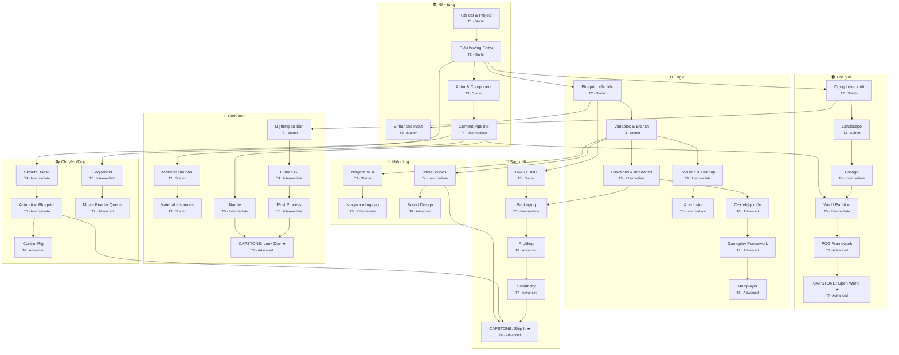

# Unreal Engine 5.8 — Skill Tree (bản đối chiếu MD)

Sơ đồ kỹ năng dạng RPG: **trục dọc = 7 nhánh chuyên môn**, **trục ngang = 8 tier** (Tier 1–3 Starter · Tier 4–5 Intermediate · Tier 6–8 Advanced). File này đối chiếu với `unreal-skill-tree.html` — xuất trực tiếp từ cùng dữ liệu trong HTML.

**Tổng quan:** 40 kỹ năng · 7 nhánh · 8 tier · 3 node capstone ★

## Sơ đồ Mermaid (render trên GitHub)

> Ghi chú: mỗi subgraph là một nhánh, ô liệt kê theo tier; mũi tên `A --> B` = học B cần biết A trước. Mermaid tự xếp layout nên **hình khác HTML** (HTML là lưới lane × tier) — hãy so **nhóm nhánh + quan hệ mũi tên**, không so vị trí ô.

## Chi tiết từng nhánh

### 🏛 Nền tảng (5 kỹ năng)

| Tier | Cấp | Kỹ năng | Thuật ngữ EN | Yêu cầu trước | Khóa học | Docs mirror |
|---|---|---|---|---|---|---|
| T1 | Starter | **Cài đặt & Project** | Install · Project Setup | — | [Ch.1](khoa-hoc-unreal-engine.html#ch1) | [install-unreal-engine](unreal-engine-5.8-docs/site/install-unreal-engine/) [module-1-install-ue-and-create-your-first-project](unreal-engine-5.8-docs/site/module-1-install-ue-and-create-your-first-project/) |
| T2 | Starter | **Điều hướng Editor** | Editor Interface | `Cài đặt & Project` | [Ch.2](khoa-hoc-unreal-engine.html#ch2) | [unreal-editor-interface](unreal-engine-5.8-docs/site/unreal-editor-interface/) [tools-and-editors-in-unreal-engine](unreal-engine-5.8-docs/site/tools-and-editors-in-unreal-engine/) |
| T3 | Starter | **Actor & Component** | Actor · Component · Transform | `Điều hướng Editor` | [Ch.3](khoa-hoc-unreal-engine.html#ch3) | [actors-in-unreal-engine](unreal-engine-5.8-docs/site/actors-in-unreal-engine/) [transforming-actors-in-unreal-engine](unreal-engine-5.8-docs/site/transforming-actors-in-unreal-engine/) |
| T3 | Starter | **Enhanced Input** | IA · IMC · SaveGame | `Blueprint căn bản` | [Ch.8](khoa-hoc-unreal-engine.html#ch8) | [enhanced-input-in-unreal-engine](unreal-engine-5.8-docs/site/enhanced-input-in-unreal-engine/) [saving-and-loading-your-game-in-unreal-engine](unreal-engine-5.8-docs/site/saving-and-loading-your-game-in-unreal-engine/) |
| T4 | Intermediate | **Content Pipeline** | Import · Interchange | `Actor & Component` | [Ch.5](khoa-hoc-unreal-engine.html#ch5) | [importing-assets-using-interchange-in-unreal-engine](unreal-engine-5.8-docs/site/importing-assets-using-interchange-in-unreal-engine/) [importing-static-meshes-in-unreal-engine](unreal-engine-5.8-docs/site/importing-static-meshes-in-unreal-engine/) |

### 🌍 Thế giới (6 kỹ năng)

| Tier | Cấp | Kỹ năng | Thuật ngữ EN | Yêu cầu trước | Khóa học | Docs mirror |
|---|---|---|---|---|---|---|
| T2 | Starter | **Dựng Level khối** | Blocking · Player Start | `Điều hướng Editor` | [Ch.3](khoa-hoc-unreal-engine.html#ch3) | [level-designer-quick-start-in-unreal-engine](unreal-engine-5.8-docs/site/level-designer-quick-start-in-unreal-engine/) |
| T3 | Starter | **Landscape** | Landscape Sculpt & Paint | `Dựng Level khối` | [Ch.10](khoa-hoc-unreal-engine.html#ch10) | [landscape-quick-start-guide-in-unreal-engine](unreal-engine-5.8-docs/site/landscape-quick-start-guide-in-unreal-engine/) [landscape-materials-in-unreal-engine](unreal-engine-5.8-docs/site/landscape-materials-in-unreal-engine/) |
| T4 | Intermediate | **Foliage** | Foliage Painting | `Landscape` | [Ch.10](khoa-hoc-unreal-engine.html#ch10) | [foliage-mode-in-unreal-engine](unreal-engine-5.8-docs/site/foliage-mode-in-unreal-engine/) |
| T5 | Intermediate | **World Partition** | World Partition · Data Layers | `Foliage`, `Content Pipeline` | [Ch.21](khoa-hoc-unreal-engine.html#ch21) | [world-partition-in-unreal-engine](unreal-engine-5.8-docs/site/world-partition-in-unreal-engine/) [world-partition---data-layers-in-unreal-engine](unreal-engine-5.8-docs/site/world-partition---data-layers-in-unreal-engine/) |
| T6 | Advanced | **PCG Framework** | Procedural Content Generation | `World Partition` | [Ch.23](khoa-hoc-unreal-engine.html#ch23) | [procedural-content-generation-overview](unreal-engine-5.8-docs/site/procedural-content-generation-overview/) [pcg-editor-mode-in-unreal-engine](unreal-engine-5.8-docs/site/pcg-editor-mode-in-unreal-engine/) |
| T7 | Advanced | **★ CAPSTONE: Open World** | Open World Slice | `PCG Framework` | [Ch.26](khoa-hoc-unreal-engine.html#ch26) | [city-sample-pcg-for-unreal-engine](unreal-engine-5.8-docs/site/city-sample-pcg-for-unreal-engine/) |

### ⚙️ Logic (8 kỹ năng)

| Tier | Cấp | Kỹ năng | Thuật ngữ EN | Yêu cầu trước | Khóa học | Docs mirror |
|---|---|---|---|---|---|---|
| T2 | Starter | **Blueprint căn bản** | Event · Node · Wire | `Điều hướng Editor` | [Ch.4](khoa-hoc-unreal-engine.html#ch4) | [blueprints-visual-scripting-in-unreal-engine](unreal-engine-5.8-docs/site/blueprints-visual-scripting-in-unreal-engine/) [module-3-create-a-coin-pickup-with-modeling-tools-and-blueprints](unreal-engine-5.8-docs/site/module-3-create-a-coin-pickup-with-modeling-tools-and-blueprints/) |
| T3 | Starter | **Variables & Branch** | Variables · Flow Control | `Blueprint căn bản` | [Ch.4](khoa-hoc-unreal-engine.html#ch4) | [blueprint-variables-in-unreal-engine](unreal-engine-5.8-docs/site/blueprint-variables-in-unreal-engine/) [blueprint-communications-in-unreal-engine](unreal-engine-5.8-docs/site/blueprint-communications-in-unreal-engine/) |
| T4 | Intermediate | **Collision & Overlap** | Collision Presets | `Variables & Branch` | [Ch.11](khoa-hoc-unreal-engine.html#ch11) | [collision-in-unreal-engine](unreal-engine-5.8-docs/site/collision-in-unreal-engine/) [physics-in-unreal-engine](unreal-engine-5.8-docs/site/physics-in-unreal-engine/) |
| T5 | Intermediate | **AI cơ bản** | NavMesh · Perception · BT | `Collision & Overlap` | [Ch.12](khoa-hoc-unreal-engine.html#ch12) | [behavior-trees-in-unreal-engine](unreal-engine-5.8-docs/site/behavior-trees-in-unreal-engine/) [navigation-system-in-unreal-engine](unreal-engine-5.8-docs/site/navigation-system-in-unreal-engine/) [ai-perception-in-unreal-engine](unreal-engine-5.8-docs/site/ai-perception-in-unreal-engine/) |
| T5 | Intermediate | **Functions & Interfaces** | Functions · Interfaces | `Variables & Branch` | [Ch.4](khoa-hoc-unreal-engine.html#ch4) | [blueprint-function-libraries-in-unreal-engine](unreal-engine-5.8-docs/site/blueprint-function-libraries-in-unreal-engine/) [implementing-blueprint-interfaces-in-unreal-engine](unreal-engine-5.8-docs/site/implementing-blueprint-interfaces-in-unreal-engine/) |
| T6 | Advanced | **C++ nhập môn** | C++ Basics · UPROPERTY | `Functions & Interfaces` | [Ch.19](khoa-hoc-unreal-engine.html#ch19) | [coder-01-set-up-and-compile-a-cplusplus-project-in-unreal-engine](unreal-engine-5.8-docs/site/coder-01-set-up-and-compile-a-cplusplus-project-in-unreal-engine/) [exposing-cplusplus-to-blueprints-visual-scripting-in-unreal-engine](unreal-engine-5.8-docs/site/exposing-cplusplus-to-blueprints-visual-scripting-in-unreal-engine/) |
| T7 | Advanced | **Gameplay Framework** | GameMode · Pawn · Controller | `C++ nhập môn` | [Ch.19](khoa-hoc-unreal-engine.html#ch19) | [game-mode-and-game-state-in-unreal-engine](unreal-engine-5.8-docs/site/game-mode-and-game-state-in-unreal-engine/) [pawn-in-unreal-engine](unreal-engine-5.8-docs/site/pawn-in-unreal-engine/) |
| T8 | Advanced | **Multiplayer** | Replication · RPC | `Gameplay Framework` | [Ch.24](khoa-hoc-unreal-engine.html#ch24) | [basics-of-network-multiplayer-in-unreal-engine](unreal-engine-5.8-docs/site/basics-of-network-multiplayer-in-unreal-engine/) [multiplayer-programming-quick-start-for-unreal-engine](unreal-engine-5.8-docs/site/multiplayer-programming-quick-start-for-unreal-engine/) |

### 🎨 Hình ảnh (7 kỹ năng)

| Tier | Cấp | Kỹ năng | Thuật ngữ EN | Yêu cầu trước | Khóa học | Docs mirror |
|---|---|---|---|---|---|---|
| T2 | Starter | **Material căn bản** | Base Color · Metallic · Roughness | `Content Pipeline` | [Ch.6](khoa-hoc-unreal-engine.html#ch6) | [artist-03-create-materials-and-material-instances](unreal-engine-5.8-docs/site/artist-03-create-materials-and-material-instances/) [physically-based-materials-in-unreal-engine](unreal-engine-5.8-docs/site/physically-based-materials-in-unreal-engine/) |
| T3 | Starter | **Lighting cơ bản** | Direct · Sky · Fog | `Dựng Level khối` | [Ch.7](khoa-hoc-unreal-engine.html#ch7) | [lighting-the-environment-in-unreal-engine](unreal-engine-5.8-docs/site/lighting-the-environment-in-unreal-engine/) [features-and-properties-of-lights-in-unreal-engine](unreal-engine-5.8-docs/site/features-and-properties-of-lights-in-unreal-engine/) |
| T3 | Starter | **Material Instances** | Parameters · Instances | `Material căn bản` | [Ch.6](khoa-hoc-unreal-engine.html#ch6) | [artist-03-create-materials-and-material-instances](unreal-engine-5.8-docs/site/artist-03-create-materials-and-material-instances/) [instanced-materials-in-unreal-engine](unreal-engine-5.8-docs/site/instanced-materials-in-unreal-engine/) |
| T4 | Intermediate | **Lumen GI** | Global Illumination | `Lighting cơ bản` | [Ch.9](khoa-hoc-unreal-engine.html#ch9) | [lumen-global-illumination-and-reflections-in-unreal-engine](unreal-engine-5.8-docs/site/lumen-global-illumination-and-reflections-in-unreal-engine/) [local-fog-volumes-in-unreal-engine](unreal-engine-5.8-docs/site/local-fog-volumes-in-unreal-engine/) |
| T5 | Intermediate | **Nanite** | Virtualized Geometry | `Content Pipeline` | [Ch.22](khoa-hoc-unreal-engine.html#ch22) | [nanite-virtualized-geometry-in-unreal-engine](unreal-engine-5.8-docs/site/nanite-virtualized-geometry-in-unreal-engine/) [nanite-technical-details](unreal-engine-5.8-docs/site/nanite-technical-details/) |
| T5 | Intermediate | **Post Process** | Exposure · Color Grading | `Lumen GI` | [Ch.9](khoa-hoc-unreal-engine.html#ch9) | [post-process-effects-in-unreal-engine](unreal-engine-5.8-docs/site/post-process-effects-in-unreal-engine/) |
| T7 | Advanced | **★ CAPSTONE: Look Dev** | Art Direction Pass | `Post Process`, `Nanite` | [Ch.9](khoa-hoc-unreal-engine.html#ch9) | [07-adjust-environment-lighting-features](unreal-engine-5.8-docs/site/07-adjust-environment-lighting-features/) |

### ✨ Hiệu ứng (4 kỹ năng)

| Tier | Cấp | Kỹ năng | Thuật ngữ EN | Yêu cầu trước | Khóa học | Docs mirror |
|---|---|---|---|---|---|---|
| T3 | Starter | **Niagara VFX** | System · Emitter · Module | `Variables & Branch` | [Ch.14](khoa-hoc-unreal-engine.html#ch14) | [overview-of-niagara-effects-for-unreal-engine](unreal-engine-5.8-docs/site/overview-of-niagara-effects-for-unreal-engine/) [quick-start-for-niagara-effects-in-unreal-engine](unreal-engine-5.8-docs/site/quick-start-for-niagara-effects-in-unreal-engine/) |
| T4 | Intermediate | **MetaSounds** | Sound Sources | `Variables & Branch` | [Ch.13](khoa-hoc-unreal-engine.html#ch13) | [metasounds-in-unreal-engine](unreal-engine-5.8-docs/site/metasounds-in-unreal-engine/) [metasound-templates-quick-start-in-unreal-engine](unreal-engine-5.8-docs/site/metasound-templates-quick-start-in-unreal-engine/) |
| T5 | Intermediate | **Niagara nâng cao** | GPU Sim · Events | `Niagara VFX` | [Ch.14](khoa-hoc-unreal-engine.html#ch14) | [debugging-and-optimization-in-niagara-effects-for-unreal-engine](unreal-engine-5.8-docs/site/debugging-and-optimization-in-niagara-effects-for-unreal-engine/) |
| T6 | Advanced | **Sound Design** | Mix · Ambient | `MetaSounds` | [Ch.13](khoa-hoc-unreal-engine.html#ch13) | [artist-09-adding-sounds-to-fire-traps-artist-track-unreal-engine](unreal-engine-5.8-docs/site/artist-09-adding-sounds-to-fire-traps-artist-track-unreal-engine/) [audio-volume-actor-in-unreal-engine](unreal-engine-5.8-docs/site/audio-volume-actor-in-unreal-engine/) |

### 🎭 Chuyển động (5 kỹ năng)

| Tier | Cấp | Kỹ năng | Thuật ngữ EN | Yêu cầu trước | Khóa học | Docs mirror |
|---|---|---|---|---|---|---|
| T4 | Intermediate | **Skeletal Mesh** | Skeleton · Physics Asset | `Content Pipeline` | [Ch.15](khoa-hoc-unreal-engine.html#ch15) | [skeletal-mesh-assets-in-unreal-engine](unreal-engine-5.8-docs/site/skeletal-mesh-assets-in-unreal-engine/) [animation-retargeting-in-unreal-engine](unreal-engine-5.8-docs/site/animation-retargeting-in-unreal-engine/) |
| T5 | Intermediate | **Animation Blueprint** | Anim Graph · State Machine | `Skeletal Mesh` | [Ch.15](khoa-hoc-unreal-engine.html#ch15) | [animation-blueprints-in-unreal-engine](unreal-engine-5.8-docs/site/animation-blueprints-in-unreal-engine/) |
| T5 | Intermediate | **Sequencer** | Cinematics Timeline | `Điều hướng Editor` | [Ch.17](khoa-hoc-unreal-engine.html#ch17) | [cinematics-and-movie-making-in-unreal-engine](unreal-engine-5.8-docs/site/cinematics-and-movie-making-in-unreal-engine/) [sequencer-cinematic-editor-unreal-engine](unreal-engine-5.8-docs/site/sequencer-cinematic-editor-unreal-engine/) |
| T6 | Advanced | **Control Rig** | Procedural Animation | `Animation Blueprint` | [Ch.15](khoa-hoc-unreal-engine.html#ch15) | [how-to-create-control-rigs-in-unreal-engine](unreal-engine-5.8-docs/site/how-to-create-control-rigs-in-unreal-engine/) |
| T7 | Advanced | **Movie Render Queue** | MRQ Render | `Sequencer` | [Ch.17](khoa-hoc-unreal-engine.html#ch17) | [rendering-out-cinematic-movies-in-unreal-engine](unreal-engine-5.8-docs/site/rendering-out-cinematic-movies-in-unreal-engine/) |

### 🚀 Sản xuất (5 kỹ năng)

| Tier | Cấp | Kỹ năng | Thuật ngữ EN | Yêu cầu trước | Khóa học | Docs mirror |
|---|---|---|---|---|---|---|
| T3 | Starter | **UMG / HUD** | Widget Blueprint | `Blueprint căn bản` | [Ch.16](khoa-hoc-unreal-engine.html#ch16) | [umg-ui-designer-quick-start-guide-in-unreal-engine](unreal-engine-5.8-docs/site/umg-ui-designer-quick-start-guide-in-unreal-engine/) [designer-04-player-hud-in-unreal-engine](unreal-engine-5.8-docs/site/designer-04-player-hud-in-unreal-engine/) |
| T5 | Intermediate | **Packaging** | Cook · Build · Ship | `Functions & Interfaces`, `UMG / HUD` | [Ch.18](khoa-hoc-unreal-engine.html#ch18) | [packaging-your-project](unreal-engine-5.8-docs/site/packaging-your-project/) [build-configurations-reference-for-unreal-engine](unreal-engine-5.8-docs/site/build-configurations-reference-for-unreal-engine/) |
| T6 | Advanced | **Profiling** | Unreal Insights · stat | `Packaging` | [Ch.25](khoa-hoc-unreal-engine.html#ch25) | [unreal-insights-in-unreal-engine](unreal-engine-5.8-docs/site/unreal-insights-in-unreal-engine/) |
| T7 | Advanced | **Scalability** | Auto Quality | `Profiling` | [Ch.25](khoa-hoc-unreal-engine.html#ch25) | [scalability-reference-for-unreal-engine](unreal-engine-5.8-docs/site/scalability-reference-for-unreal-engine/) |
| T8 | Advanced | **★ CAPSTONE: Ship It** | Vertical Slice Release | `Scalability`, `Animation Blueprint`, `MetaSounds` | [Ch.26](khoa-hoc-unreal-engine.html#ch26) | [packaging-and-shipping-in-unreal-engine](unreal-engine-5.8-docs/site/packaging-and-shipping-in-unreal-engine/) |

## Checklist tiến độ (theo tier)

Tick dần khi học — dùng song song với vòng % trong trang HTML (tiến độ HTML lưu riêng ở localStorage).

**Tier 1 — Starter**

- [ ] 🏛 Cài đặt & Project — Install · Project Setup

**Tier 2 — Starter**

- [ ] 🏛 Điều hướng Editor — Editor Interface
- [ ] 🌍 Dựng Level khối — Blocking · Player Start
- [ ] ⚙️ Blueprint căn bản — Event · Node · Wire
- [ ] 🎨 Material căn bản — Base Color · Metallic · Roughness

**Tier 3 — Starter**

- [ ] 🏛 Actor & Component — Actor · Component · Transform
- [ ] 🏛 Enhanced Input — IA · IMC · SaveGame
- [ ] 🌍 Landscape — Landscape Sculpt & Paint
- [ ] ⚙️ Variables & Branch — Variables · Flow Control
- [ ] 🎨 Lighting cơ bản — Direct · Sky · Fog
- [ ] 🎨 Material Instances — Parameters · Instances
- [ ] ✨ Niagara VFX — System · Emitter · Module
- [ ] 🚀 UMG / HUD — Widget Blueprint

**Tier 4 — Intermediate**

- [ ] 🏛 Content Pipeline — Import · Interchange
- [ ] 🌍 Foliage — Foliage Painting
- [ ] ⚙️ Collision & Overlap — Collision Presets
- [ ] 🎨 Lumen GI — Global Illumination
- [ ] ✨ MetaSounds — Sound Sources
- [ ] 🎭 Skeletal Mesh — Skeleton · Physics Asset

**Tier 5 — Intermediate**

- [ ] 🌍 World Partition — World Partition · Data Layers
- [ ] ⚙️ AI cơ bản — NavMesh · Perception · BT
- [ ] ⚙️ Functions & Interfaces — Functions · Interfaces
- [ ] 🎨 Nanite — Virtualized Geometry
- [ ] 🎨 Post Process — Exposure · Color Grading
- [ ] ✨ Niagara nâng cao — GPU Sim · Events
- [ ] 🎭 Animation Blueprint — Anim Graph · State Machine
- [ ] 🎭 Sequencer — Cinematics Timeline
- [ ] 🚀 Packaging — Cook · Build · Ship

**Tier 6 — Advanced**

- [ ] 🌍 PCG Framework — Procedural Content Generation
- [ ] ⚙️ C++ nhập môn — C++ Basics · UPROPERTY
- [ ] ✨ Sound Design — Mix · Ambient
- [ ] 🎭 Control Rig — Procedural Animation
- [ ] 🚀 Profiling — Unreal Insights · stat

**Tier 7 — Advanced**

- [ ] 🌍 CAPSTONE: Open World — Open World Slice ★ CAPSTONE
- [ ] ⚙️ Gameplay Framework — GameMode · Pawn · Controller
- [ ] 🎨 CAPSTONE: Look Dev — Art Direction Pass ★ CAPSTONE
- [ ] 🎭 Movie Render Queue — MRQ Render
- [ ] 🚀 Scalability — Auto Quality

**Tier 8 — Advanced**

- [ ] ⚙️ Multiplayer — Replication · RPC
- [ ] 🚀 CAPSTONE: Ship It — Vertical Slice Release ★ CAPSTONE
